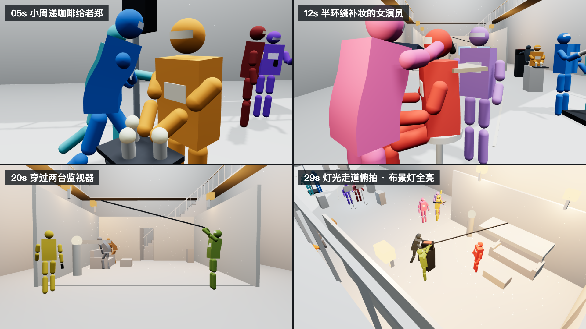

# ZPboom.AI · 3D 预演导演（zpboom-3d-previs）

把分镜脚本变成一个**能在浏览器里打开、能直接改的 3D 网页预演**：先用白膜人偶把机位、走位、动作先后和镜头衔接对好，再导出参考视频、整理生成提示词，交给 AI 视频模型去生成。

它是一个符合 [Agent Skills 规范](https://agentskills.io/specification) 的技能包，配合 Claude Code 等能读写本地文件、能开浏览器的 AI 助手使用：你用中文描述分镜，助手搭场景、写配置、自己打开网页逐镜检查；你也可以在网页里直接拖人物、调机位。



> 预演做完不等于成片做完。这个技能负责把**能提前发现的镜头问题**放到生成之前解决，最终画面的质量和尝试次数仍取决于你用的视频模型和素材。

---

## 目录

1. [能做什么](#能做什么)
2. [运行环境](#运行环境)
3. [安装](#安装)
4. [五分钟上手](#五分钟上手)
5. [开工确认：动手前会问的 4 个问题](#开工确认动手前会问的-4-个问题)
6. [人物白膜：精细白膜和简化胶囊](#人物白膜精细白膜和简化胶囊)
7. [动作方式：关键帧，或关键帧加动捕](#动作方式关键帧或关键帧加动捕)
8. [网页界面使用](#网页界面使用)（完整版见 [网页操作指南](docs/web-guide.md)）
9. [怎样修改预演](#怎样修改预演)
10. [导出参考视频（MP4）](#导出参考视频mp4)
11. [导出 Blender 工程](#导出-blender-工程)
12. [整理生成交接资料](#整理生成交接资料)
13. [命令行脚本参考](#命令行脚本参考)
14. [scene.json 是什么](#scenejson-是什么)
15. [目录结构](#目录结构)
16. [常见问题](#常见问题)
17. [许可与致谢](#许可与致谢)

---

## 能做什么

| 能力 | 说明 |
| --- | --- |
| 分镜 → 3D 预演 | 按时间码把分镜拆成机位、目标点、角色路径、道具归属、事件先后，搭成真正有透视和遮挡的 3D 场景 |
| 白膜人偶 | 每个角色一种纯色，两种外形可选（精细白膜 / 简化胶囊），自带步态、呼吸微动、手部 IK 贴合 |
| 道具与结构 | 道具换手、掉落；开门、卷帘门、升降灯架、倒塌等结构动画；灯光开关、火花、灰尘、钢索等特效 |
| 天气 | 雨、雪、雾、风、阴天、地面湿、时间段、闪电，都能上时间线 |
| 网页里直接编辑 | 点选拖动人物、道具、场景物件；逐对象关键帧轨道；撤销重做；Ctrl+S 直接保存到工程 |
| 镜头工具 | 自由观察、俯视平面图、镜头小窗、相机路径可拖、运镜微调、FOV 滑杆、切分 / 删除镜头 |
| 动作捕捉 | 播放 FBX 动捕片段；或者用手机拍一段视频，在网页里本机识别成动作（不上传视频） |
| 导出 | 逐帧导出不掉帧的 MP4（可选画幅、清晰度、提亮 / 平光 / 深度图）；导出带完整动画的 Blender 工程 |
| 生成交接 | 按完整镜头分段，生成提示词、裁切计划、上传与检查清单 |

**它不做的事**：不包含任何视频生成模型、API 密钥或在线代生成服务；不会自动上传你的素材、发帖或改系统设置。

---

## 运行环境

| 需要 | 说明 |
| --- | --- |
| AI 助手 | 支持 Agent Skills 的宿主，例如 [Claude Code](https://claude.com/claude-code)。助手需要能读写本地文件、运行命令；能操作浏览器时会自己打开网页截图检查 |
| Python 3.9+ | 运行脚本和本地网页服务，不需要安装任何第三方包 |
| 浏览器 | **Chrome 或 Edge**（推荐）。需要 WebGL2；逐帧导出 MP4 需要 WebCodecs。Safari 能打开和编辑，但「视频动捕」在 Safari 里会崩溃 |
| Blender（可选） | 3.6 以上（Intel Mac 建议 4.5 LTS），只在要导出 Blender 工程时需要 |

所有运行库（Three.js r160、mp4-muxer、MediaPipe 姿态识别）都已随包放在 `assets/previs-starter/vendor/`，**离线也能用**。

---

## 安装

### Claude Code

把整个 `zpboom-3d-previs` 文件夹放进技能目录，确保最终路径是：

```text
~/.claude/skills/zpboom-3d-previs/SKILL.md
```

两种方式任选：

```bash
# 方式 1：从 GitHub 克隆
git clone https://github.com/zpboom324-star/zpboom-3d-previs.git /tmp/zpboom-3d-previs-repo
cp -R /tmp/zpboom-3d-previs-repo/zpboom-3d-previs ~/.claude/skills/
```

```text
方式 2：在 https://github.com/zpboom324-star/zpboom-3d-previs 点 Code → Download ZIP，
把解压出来的 zpboom-3d-previs 文件夹放进 ~/.claude/skills/
```

Windows 的技能目录是 `%USERPROFILE%\.claude\skills\`。装好后重开一个会话，技能列表里应能看到 `zpboom-3d-previs`。

### 其他宿主

`SKILL.md` 用的是通用 Agent Skills 格式（name / description + 资源文件），`agents/openai.yaml` 提供了显示名称和默认提示。其他支持该规范的宿主，按它自己的文档把文件夹放进技能目录即可。

---

## 五分钟上手

### 1. 发出第一条请求

在 AI 助手里直接说：

```text
使用 zpboom-3d-previs。帮我做一个 15 秒、16:9 的预演，工程放在 ~/Documents/我的预演。
分镜如下：
0–5 秒：雨夜小巷，A 撑伞从画左走进来，停在路灯下看表。
5–10 秒：B 从 A 身后的阴影里走出来，拍了一下 A 的肩膀，A 吓得转身。
10–15 秒：两人对视，A 把伞递给 B，B 接过伞，两人一起往画右走出画。
```

分镜写得越具体越好：时间码、谁在哪、谁朝哪、谁拿什么、镜头怎么动。没写清楚的地方，助手会先问。

### 2. 回答开工确认

助手读完分镜后，会**一次性**问你 4 个问题（见下一节）。在第一句话里写清楚就会跳过提问。

### 3. 等它搭好、自己检查

助手会：

1. 用模板新建工程（`scripts/new_project.py`）；
2. 按分镜改写场景、人物、道具、走位和机位（`scene.json`）；
3. 用本地服务打开网页，读数值核对手部接触、道具位置，再截图检查每个镜头的起点、中间、终点和切点；
4. 告诉你在哪个地址打开、改了什么、哪些地方和分镜不一样。

### 4. 自己打开看

```bash
python3 -m http.server 8000 --bind 127.0.0.1 --directory ~/Documents/我的预演
```

浏览器打开 `http://127.0.0.1:8000`。**不能直接双击 index.html**（ES 模块需要 HTTP 服务）。

### 5. 改到满意，再导出

用嘴改（「3–5 秒镜头往左移一点」）或在网页里自己拖都可以，满意后导出 MP4、整理生成交接资料。

### 你会得到的工程

```text
我的预演/
├── index.html / app.js / editor.js / viewtools.js / weather.js / videomocap.js / styles.css
├── vendor/              运行库（Three.js、mp4-muxer、MediaPipe）
├── scene.json           全部内容：场景、人物、道具、走位、机位、天气……
├── asset-map.json       角色—外观图—专属道具—场景的绑定表
├── storyboard.md        分镜依据和需要人工判断的地方
├── revision-log.md      开工确认、每一版改了什么、检查结果
├── blender_setup.py     把导出的 GLB 变成 .blend 的脚本
└── generation/          生成交接资料（整理之后才有）
```

---

## 开工确认：动手前会问的 4 个问题

为了避免做完再返工，新建工程前助手会读完分镜，然后一次问完下面 4 题（每题第一个选项是推荐项）：

| 题目 | 选项 | 为什么要先问 |
| --- | --- | --- |
| 人物白膜 | 精细白膜 / 简化胶囊 | 决定参考视频里人物长什么样、道具显不显示 |
| 预演画面亮度 | 明亮可读，夜景和低调光写进提示词（推荐）/ 按分镜影调做暗 | 太暗的预演容易被视频模型读黑，事后提亮要重调灯光 |
| 分镜机位和空间冲突时 | 保持空间真实，机位就近调整并标注（推荐）/ 严格按分镜，必要时改场景尺寸 | 窄通道、室内经常装不下分镜写的机位 |
| 这次做到哪一步 | 只做预演 / 加导出参考视频 / 再加生成交接 | 决定交付范围 |

想跳过提问，在第一句话里写清楚：

```text
使用 zpboom-3d-previs。简化胶囊白膜；画面明亮可读；机位装不下时保持空间真实、偏离处标注；
这次做到预演 + 导出参考视频。下面是分镜……
```

回答会记进工程的 `revision-log.md`「开工确认」一节，之后改这个工程都按它来。动作方式**不在这里问**，没说就用关键帧（见后文）。

---

## 人物白膜：精细白膜和简化胶囊

| | 精细白膜 | 简化胶囊 |
| --- | --- | --- |
| 外形 | 球头 + 眼带（标出视线）、可弯曲的方块躯干（胸前名牌标出朝向）、两节胶囊四肢 | 球头紧贴一条与头同直径的胶囊身体，没有四肢和五官，底端离地约 16 厘米悬浮 |
| 动作表现 | 四肢、手部接触都看得清 | 走、跑、扑、倒地时是一根直的胶囊，整体随重心前倾、倾倒；只有下蹲、坐下才弯曲 |
| 道具 | 显示 | 不显示（位置照常计算） |
| 适合 | 要看清接触和四肢动作，或者要拿去微调动作模型 | 拿参考视频去生成：模型不会照抄白膜的僵硬关节，表演发挥空间更大 |

两种**只换外形、不改动作**。网页顶栏画幅旁的「精细白膜 / 简化胶囊」下拉可以随时一键切换（Ctrl+Z 撤销），保存后写进 `scene.json` 的 `world.figure`。选简化胶囊时，生成提示词会自动说明「四肢、手部、表情和道具按提示词与参考图重新生成」。

---

## 动作方式：关键帧，或关键帧加动捕

| | 方式 1 · 关键帧直接做（默认） | 方式 2 · 混合（关键帧 + 动捕） |
| --- | --- | --- |
| 人物动作 | 姿态库关键帧 + IK 贴合 + 步态 + 呼吸微动 | 走位、机位、接触用关键帧；摔倒、打斗、舞蹈等全身动作换成动捕片段 |
| 需要的素材 | 不需要 | FBX 动作文件，或一段手机视频 |
| 适合 | 走位、对峙、机位节奏为主 | 重心、惯性、力量感要像真人 |

不说就是方式 1。说「动捕 / Mixamo / FBX / 动作文件」就是方式 2。两种随时可以互换。

### 视频动捕（不用动捕设备）

1. 用手机拍一段真人做动作的视频：手机固定、全身入画、光线充足、尽量只有一个人。
2. 在网页里选中角色 →「角色 · 姿态」页 →「视频动捕」→ 选视频 →「识别动作」。识别在本机完成，**视频不上传**。
3. 识别完会临时套到所选角色上：点「▶ 对比播放」或拖滑杆，和原视频逐帧对照。
4. 设「起点」（动作从第几秒开始），选「原有动作」怎么处理：叠加 / 覆盖姿态 / 完全覆盖。
5. 满意了点「加到角色」，不满意直接关掉。原关键帧不删，Ctrl+Z 可撤销。

复杂动作（摔倒、打斗、地板动作）可以勾「精细识别」，最难的几帧少认错，但识别慢 2–4 倍。人偶会自动踩地，视频里双脚离地的跳跃会真的跳起来。**请用 Chrome 或 Edge 做视频动捕。**

### FBX 动作文件

Mixamo 等动作库下载时选 FBX Binary、30 fps、移动类动作勾 In Place。文件放进工程的 `motions/`，告诉助手哪个角色在第几秒播哪段即可。字段说明见 [references/motion-capture.md](references/motion-capture.md)。

---

## 网页界面使用

> 每个按钮、面板、对话框的逐项说明和常用操作流程，见 **[网页操作指南](docs/web-guide.md)**。下面是速览。

界面是固定的剪辑软件风格：顶栏、画面、时间线、右侧检查器（「角色 · 姿态 / 镜头 / 天气 / 说明」四页）。

### 播放与快捷键

| 操作 | 按键 |
| --- | --- |
| 播放 / 暂停 | 空格 |
| 逐帧 | ← → |
| 前后 1 秒 | Shift + ← → |
| 上一镜 / 下一镜 | [ ] |
| 回到开头 | Home |
| 退出干净画面 | Esc |

时间线上单击镜头块跳到该镜开头，按住拖动是拖播放头。

### 在画面里直接编辑

| 操作 | 按键 |
| --- | --- |
| 选中 | 点画面里的人物、道具、场景物件 |
| 移动 / 旋转 / 缩放 | W / E / R（缩放只对场景物件） |
| 自动关键帧开关 | N |
| 手动记关键帧 | K（没选中对象时，记当前画面为相机关键帧） |
| 删除 / 复制 / 粘贴关键帧 | Delete / Ctrl+C / Ctrl+V |
| 撤销 / 重做 | Ctrl+Z / Ctrl+Shift+Z（或 Ctrl+Y），最多 100 步 |
| 保存到 scene.json | Ctrl+S |

- 时间线上每个人物、道具、结构动画各有一条关键帧轨道，相机一条。点关键帧跳过去，左右拖动改时间。
- Chrome / Edge 第一次保存会让你选中工程里的 `scene.json`，之后直接覆盖；其他浏览器改为下载。每次改动都会自动存草稿，没保存就关掉，下次打开会提示恢复。

### 镜头工具

| 工具 | 用法 |
| --- | --- |
| 自由观察 | 左键环绕、右键（或 Shift+左键）平移、滚轮推拉；按住右键 + W/A/S/D 飞行，Q/E 升降；F 聚焦选中对象 |
| 俯视（T） | 正上方平面图，剖掉 2.2 米以上的屋顶，可以直接拖人物和相机路径点 |
| 小窗 | 自由观察 / 俯视时右下角显示分镜相机的实际画面 |
| 相机路径 | 橙线是相机路径、蓝线是看向路径，圆点是关键帧，可以拖 |
| 设为镜头机位（K） | 把自由观察里找好的画面记成当前镜头的相机关键帧 |
| 运镜微调 | 推 / 拉 / 升 / 降 / 左移 / 右移 / 摇 / 俯仰，三档步长 |
| FOV 滑杆 | 旁边显示等效焦距（16:9 下 28mm ≈ 46°，35mm ≈ 38°，50mm ≈ 27°） |
| 镜头管理 | 改镜头名、在播放头切分、删除此镜、拖动镜头之间的切点 |

### 天气与姿态

- **天气页**：晴 / 阴 / 小雨 / 大雨 / 雷雨 / 雪 / 大雾预设和滑杆，都记在播放头处，可以加闪电。屋顶、桌面下面不下雨。
- **姿态卡片**：选中角色后，可以在播放头处换姿态库姿态、拖 14 个关节滑杆微调（也能修正动捕），设置手部接触（选目标或拖小球）。

### 画幅

工程画幅在顶栏随时切换（可撤销）；每个镜头可以单独设画幅（自动加黑边），并显示其他画幅的取景参考线。

---

## 怎样修改预演

**让助手改**，直接说时间段和要改的东西：

```text
5–10 秒的镜头，B 的肩膀挡住了 A。相机沿画面右侧平移一点，目标仍然对着 A 和门之间，人物路径不变。
保存为 v02，检查切点前后，告诉我改了哪个镜头和哪些参数。
```

```text
把全片改成 9:16，重新构图让关键动作完整入画，不能只把原画面裁窄。
```

助手会区分「镜头左移」（改相机）和「A 往左一步」（改角色）。画面左右有歧义时，会结合画面说明或问你。

**自己在网页里改**：拖完按 Ctrl+S 保存。

> **注意**：复杂场景助手会在工程的 `tools/` 里写一个生成 `scene.json` 的脚本。**你在网页里改过并保存之后，就不要再运行这个脚本**，否则会覆盖网页里的修改。之后让助手改时，它会先读最新的 `scene.json`。

---

## 导出参考视频（MP4）

顶栏「导出 MP4」会弹出设置：

| 设置 | 说明 |
| --- | --- |
| 画幅 | 默认跟工程一致；也可以另选，例如工程 16:9、导出 21:9（「裁切」上下裁掉，「扩展」两边多看到场景） |
| 清晰度 | 720p / 1080p / 4K。16:9 为 1920×1080，21:9 为 2520×1080，9:16 为 1080×1920 |
| 画面 | 原样光照 / 提亮参考（推荐给视频模型）/ 白膜平光（只看形体动作）/ 深度图（近白远黑） |

导出是**逐帧渲染**：每一帧按 1/fps 采样，用浏览器 WebCodecs 编码 H.264，时长和帧数与配置完全一致，不会掉帧；导出时自动隐藏网格、标签和工作光。浏览器不支持 WebCodecs 时会退回实时录制 WebM（可能掉帧）。

**夜景、暗场**：网页会提示过暗的镜头。在「镜头」页点「参考提亮 · 自动」，导出时选「提亮参考」；夜晚、冷光等氛围写进生成提示词。

---

## 导出 Blender 工程

需要在 Blender 里精修机位灯光、换真实角色、交给动画师时：

1. 网页右上角点「导出 Blender」，下载 `<标题>_blender.glb`（人物关节、道具、结构动画、每镜一台相机、灯光，逐帧完整动画）。
2. 打开 Blender → 切到「Scripting / 脚本」工作区 → 打开工程里的 `blender_setup.py` → 点运行。脚本会找到最新的 GLB，导入并在旁边保存同名 `.blend`（已存在就另存为 `_v2`，不会覆盖你改过的工程）。
3. 或者命令行：

```bash
blender -b -P blender_setup.py -- <标题>_blender.glb
```

生成的 `.blend` 已设好帧率、分辨率、按镜头标记自动切相机、灯光强度和世界光。详见 [references/blender-export.md](references/blender-export.md)。

---

## 整理生成交接资料

预演满意、导出参考视频之后：

```bash
python3 scripts/prepare_generation.py --scene ./我的预演/scene.json --assets ./我的预演/asset-map.json --output ./我的预演/generation
```

会生成：

| 文件 | 内容 |
| --- | --- |
| `01-生成提示词.txt` | 每段的生成提示词：素材绑定、参考使用范围、逐镜动作和机位、声音、复查项 |
| `clip-plan.json` | 每段从原预演取哪一段（按完整镜头分组） |
| `上传与检查.md` | 上传顺序和检查清单 |

可以加 `--segment-seconds 15` 按约 15 秒分段（只是规划目标，复杂事件不会从中间拆开）。**这个脚本不会裁切或生成视频**，也不会上传任何东西。

提示词的分工原则：参考视频约束机位、构图、空间和事件顺序；参考图约束人物身份、服装、道具和场景；最终表演重新生成，不继承白膜的僵硬步频、滑步和关节抽动。上传标签必须和你实际上传的界面一致，没绑定的会保留具名占位。

完整示例见 [references/complete-example.md](references/complete-example.md)（随包示范案例的两段交接提示词）。

---

## 命令行脚本参考

脚本路径相对于技能目录（`~/.claude/skills/zpboom-3d-previs/`）。Windows 如果只有 `python` 或 `py`，把 `python3` 换掉即可。

### new_project.py：新建工程

```bash
python3 scripts/new_project.py --output "./我的预演" --title "我的短片" --duration 15 --fps 30 --aspect 16:9 \
  --motion keyframe --figure jointed --lighting readable --camera space --deliver previs
```

| 参数 | 可选值 | 说明 |
| --- | --- | --- |
| `--output` | 路径 | 工程目录（必填） |
| `--title` | 文字 | 标题 |
| `--duration` / `--fps` | 秒 / 帧率 | 默认 15 秒、30fps；示范案例的时码会按比例缩放 |
| `--aspect` | 16:9 / 21:9 / 9:16 / 1:1 / 4:3 / 3:4 | 画幅 |
| `--motion` | keyframe / mixed | 方式 1 / 方式 2（mixed 会建好 `motions/`） |
| `--figure` | jointed / pill | 精细白膜 / 简化胶囊 |
| `--lighting` | readable / mood | 明亮可读 / 按分镜影调做暗 |
| `--camera` | space / storyboard | 机位冲突时保持空间真实 / 严格按分镜 |
| `--deliver` | previs / video / handoff | 交付到哪一步 |
| `--empty` | — | 只要界面和引擎的空场景 |

### validate_scene.py：检查配置

```bash
python3 scripts/validate_scene.py ./我的预演/scene.json
```

只检查结构、时码和引用错误，不能代替看画面。网页加载时还会做一次完整校验。

### prepare_generation.py：整理生成交接

见上一节。

### blender_setup.py：GLB → .blend

在 Blender 里运行，或 `blender -b -P blender_setup.py -- 文件.glb`；`python3 blender_setup.py --check` 可以不开 Blender 先检查 GLB。

---

## scene.json 是什么

一个工程的全部内容都在 `scene.json` 里，**界面和引擎文件不用改**：

| 字段 | 内容 |
| --- | --- |
| `world` | 背景、曝光、雾、地面、白膜场景、手持感、人物白膜外形 |
| `lights` | 半球光、平行光、点光、聚光 |
| `set` | 场景几何：盒子、圆柱、球、台阶、分组，带结构动画绑定 |
| `kinds` / `poses` | 人物体型、颜色；自定义姿态 |
| `actors` | 角色关键帧：位置、朝向、姿态、步态、手部接触…… |
| `props` | 道具：谁拿着、什么时候换手、放在哪 |
| `rigs` | 结构动画：开门角度、升降高度…… |
| `fx` | 特效：发光 / 开灯、火花、灰尘、钢索 |
| `weather` | 天气关键帧和闪电 |
| `cues` / `shots` | 声音提示；镜头和相机关键帧 |

全部字段见 [references/scene-format.md](references/scene-format.md)。内置能力不够时（车辆、布料、人群），可以在工程里挂一个 `extra.js` 扩展模块，不需要改引擎。

网页还提供确定性检查接口 `window.__ZPBOOM_PREVIS__`：`seek()`、`point('A.hand_R')`、`getState()`、`exportMp4({download: false})` 等，助手用它读数值核对接触和道具位置。

---

## 目录结构

```text
zpboom-3d-previs/
├── SKILL.md                    技能主说明（AI 助手读的）
├── README.md                   本教程
├── CHANGELOG.md                更新记录
├── LICENSE.txt                 许可
├── docs/web-guide.md           网页操作指南
├── docs/preview.png            示范案例截图
├── agents/openai.yaml          显示名称和默认提示
├── scripts/
│   ├── new_project.py          新建工程
│   ├── validate_scene.py       检查 scene.json
│   └── prepare_generation.py   整理生成交接
├── references/
│   ├── directing-workflow.md   导演流程
│   ├── scene-format.md         scene.json 全部字段
│   ├── motion-capture.md       动作捕捉（FBX / 视频动捕）
│   ├── blender-export.md       导出 Blender
│   ├── generation-handoff.md   生成交接
│   ├── complete-example.md     示范案例的交接提示词
│   ├── invocation-examples.md  调用示例
│   └── sources.md              来源与许可
└── assets/previs-starter/      统一模板（新工程都从这里复制）
    ├── index.html / app.js / editor.js / viewtools.js / weather.js / videomocap.js / styles.css
    ├── scene.json              示范案例「影棚开拍前的忙碌日常」
    ├── blender_setup.py
    └── vendor/                 Three.js r160、mp4-muxer、MediaPipe
```

### 随包示范案例

「影棚开拍前的忙碌日常」：30 秒斯坦尼康一镜到底、14 个角色。场务端咖啡推门进棚 → 递咖啡给推灯的灯光师 → 随灯面升起上摇 → 半环绕补妆的女演员 → 在导演和摄影指导身前后退引导 → 从两台监视器之间穿过 → 从挑杆下钻进客厅布景 → 走上金属楼梯 → 灯光走道上俯拍，副导演举手，布景灯全亮。

想直接看：

```bash
python3 -m http.server 8000 --bind 127.0.0.1 --directory ~/.claude/skills/zpboom-3d-previs/assets/previs-starter
```

---

## 常见问题

**双击 index.html 打不开 / 一片空白**
必须用本地 HTTP 服务打开（见「五分钟上手」第 4 步）。端口被占用就换一个，比如 8001。

**macOS 上 `~/Documents` 里的工程返回 404**
某些宿主的预览服务没有读取 `~/Documents` 的权限。改用终端运行 `python3 -m http.server`，再用浏览器打开。

**升级技能后页面没变化 / 新按钮点了没反应**
浏览器还在用缓存里的旧脚本。按 Cmd+Shift+R（Windows 用 Ctrl+Shift+R）强制刷新。新版本的脚本地址带版本号，正常刷新一般就够了。

**视频动捕在 Safari 里报错**
MediaPipe 在 Safari 里会崩溃，请用 Chrome 或 Edge。其他功能 Safari 都正常。

**导出的 MP4 太暗**
用「参考提亮 · 自动」，导出时选「提亮参考」。

**人物太多报错**
单个工程最多 24 个角色。门外人群这类远景可以用 `extensions` 做成群众扩展。

**在网页里改完，助手又跑了生成脚本把修改冲掉了**
告诉助手「我在网页里改过并保存了，不要再运行 tools/ 里的脚本」。技能本身也要求它先检查。

**预演做完了，为什么生成出来的人物动作还是僵硬？**
试试简化胶囊白膜，并在提示词里强调最终表演重新生成（交接脚本已经默认写了这一条）。

---

## 许可与致谢

- 本技能以 **MIT 许可** 发布，见 [LICENSE.txt](LICENSE.txt)。基于 Azhen.AI 1.0.0 版（MIT）修改与扩展，由 ZPboom.AI 整理。
- 随包第三方运行库，原许可文件保留在 `assets/previs-starter/vendor/`：
  - [Three.js](https://github.com/mrdoob/three.js) r160（含 FBX 读取器、GLTF 导出器、TransformControls）—— MIT
  - [mp4-muxer](https://github.com/Vanilagy/mp4-muxer) 5.1.3 —— MIT
  - fflate（随 Three.js FBX 读取器）—— MIT
  - [MediaPipe Tasks Vision](https://developers.google.com/mediapipe) 0.10.35 及姿态识别模型（full / heavy）—— Apache-2.0
- 参考过的开源技能和方法见 [references/sources.md](references/sources.md)。
- 版本历史见 [CHANGELOG.md](CHANGELOG.md)。
